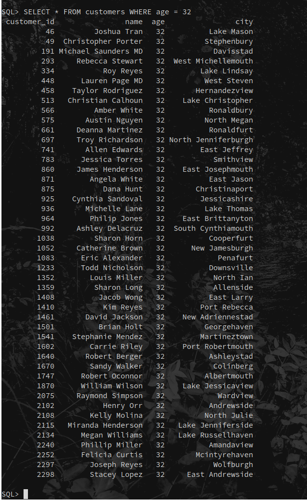

# SQLatmask v0.1.0

A very lightweight SQL‑like query engine built in Python using Pandas.
SQLatmask lets you run simplified SQL commands directly on JSON‑based tables through a command‑line interface.

## SQL Query in Sway

Example of executing a SQL query in a terminal within my Sway (Wayland) desktop environment:

## Features

- SELECT queries with column filtering
- WHERE clause with:
	- =, !=, >=, <=
	- AND, OR
	- BETWEEN
- ORDER BY (ASC / DESC)
- LIMIT
- DELETE
- JSON‑based storage (/mockdata/xxxx.json)
- Command‑line interface (CLI)

## Example Queries

- SELECT * FROM customers;

- SELECT name, age FROM customers WHERE age BETWEEN 20 AND 30;

- SELECT * FROM customers ORDER BY age DESC;

- DELETE FROM customers WHERE age < 20;

## How It Works

Tables are stored as .json files inside the mockdata/ directory (loaded at startup)
Data is loaded into pandas DataFrames at runtime
Queries are parsed using simple string‑based logic
WHERE conditions are translated into DataFrame.query() expressions

## Project Structure

Code
├── main.py        # CLI and command loop
├── cmds.py        # SQL command execution
├── iodata.py      # Load/save JSON tables
├── shelp.py       # Help banner
├── TESTALL.py     # Automated tests
└── mockdata/      # JSON data storage

## Getting Started

1. Install dependencies
'pip install pandas'

2. Run the program
'python main.py'

## Example Output

SQL> SELECT * FROM customers WHERE age BETWEEN 24 AND 27;

 name   age
 Alice  25
 Bob    26
 
 
## Limitations

- WHERE parsing is limited and a bit risky. Unexpected input might crash 
- No JOIN support
- INSERT and UPDATE removed in this version until proven stable
- Limited SQL syntax
- Values treated as strings

## Design Notes

This project started as a simple keyword-based query experiment and quickly evolved toward a more SQL-like project.

Pandas was chosen as the underlying engine because its DataFrame model naturally uses tabular data and already supports operations like filtering, sorting, and querying.
This made it possible to focus on translating SQL-like input rather than implementing a full execution layer from scratch.

This design also comes with some tradeoffs. The use of string-based parsing and direct translation to DataFrame.query() makes the system lightweight, but also less robust.
Queries are sensitive to input format, and malformed or unexpected expressions can lead to runtime errors.
A more robust implementation would require a proper parsing layer and better input validation.

## Future Plans

- Support for INSERT, UPDATE, MERGE, JOIN etc.
- Type handling (int, float)
- Better error handling
- Stronger validation
- Update of the query validation system

## What I Learned

- Using pandas as a query engine, although it wasn't all that necessary for other than training reasons.
- Pandas has got fantastic documentation easily found.

## License

MIT

## Author

Matias Back
https://github.com/framstu
